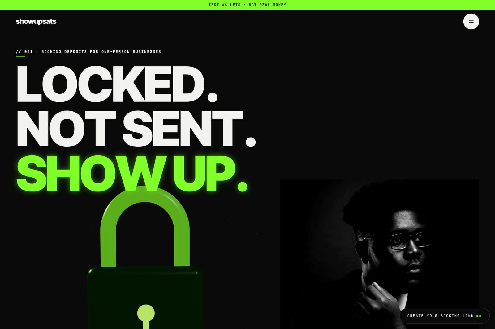
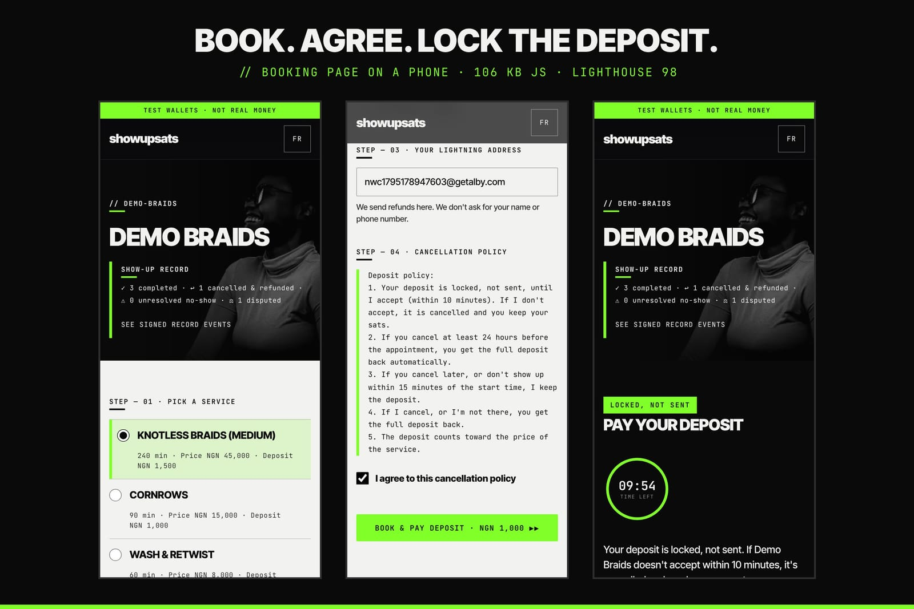
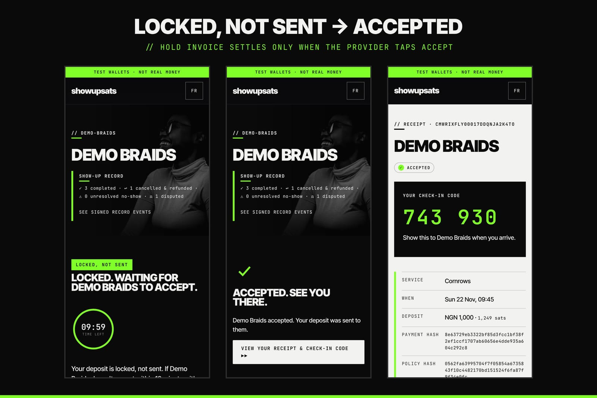
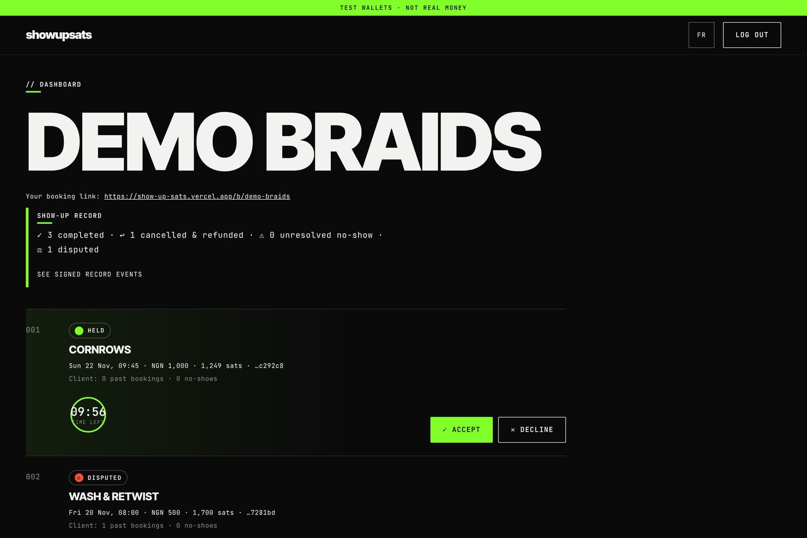
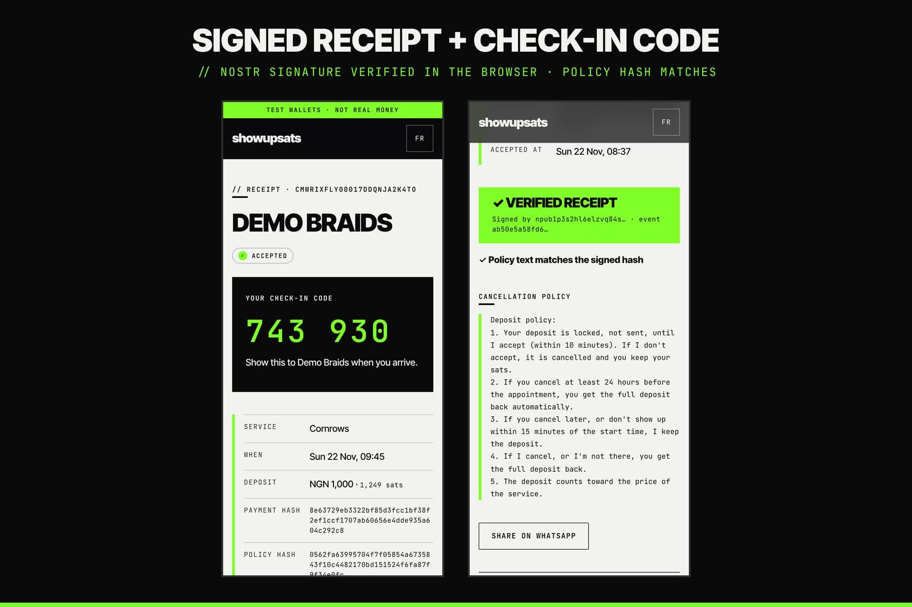
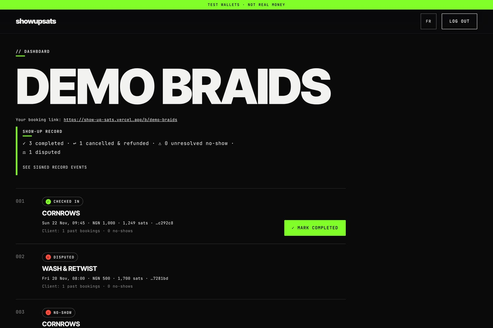
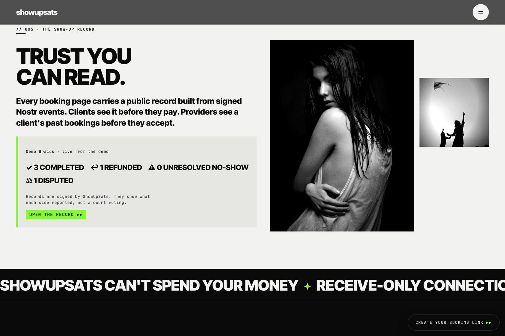
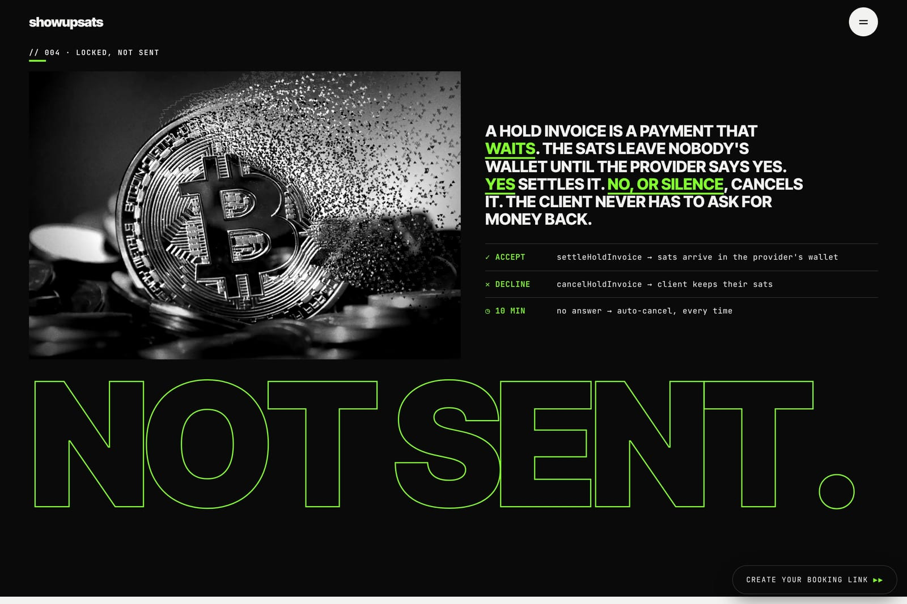
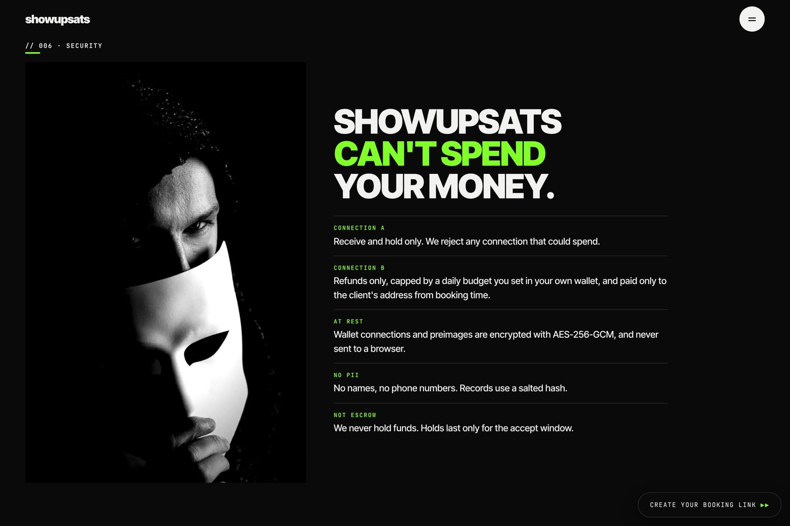
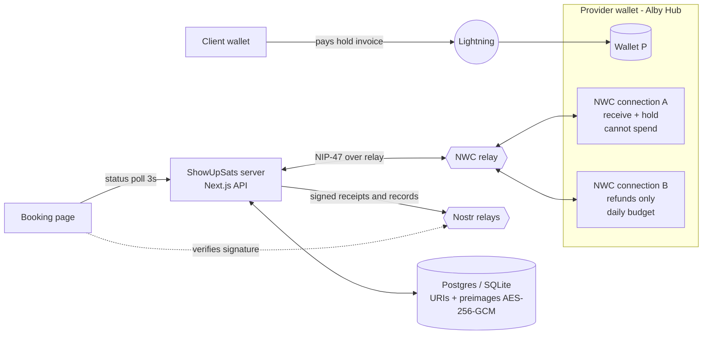

<p align="center"></p>

# ShowUpSats

**Booking links for barbers, braiders, nail techs and tutors, where the client's Lightning deposit is _locked, not sent_.** The provider accepts within 10 minutes and the sats land in their own wallet. If they decline or don't answer, the deposit is cancelled and the client keeps their sats.

**[▶ Live app](https://show-up-sats.vercel.app/)** · **[▶ Try a booking page](https://show-up-sats.vercel.app/b/demo-braids)** · [Judges: 3-minute test](#-judges-try-it-in-3-minutes) · [Run it locally](#-run-it-locally) · Built for **Dakar Bitcoin Hack 2026**

> ⚠️ The live app uses **test wallets only**. The banner reads *TEST WALLETS · NOT REAL MONEY*.

---

## Contents
- **For everyone:** [The problem](#-the-problem) · [What ShowUpSats does](#what-showupsats-does) · [How it works](#-how-it-works) · [Screenshots](#-screenshots)
- **For judges:** [Try it in 3 minutes](#-judges-try-it-in-3-minutes) · [What to look for](#what-to-look-for) · [Judging criteria map](#judging-criteria--where-to-see-it)
- **For providers:** [Create your booking link](#-providers-create-your-booking-link)
- **For developers:** [Run it locally](#-run-it-locally) · [Deploy](#deploy-to-vercel--neon) · [Under the hood](#-under-the-hood)

---

## 🪑 The problem
An empty chair on a Saturday morning is a day's rent gone. One-person service businesses lose a large share of their income to no-shows. A deposit should fix it, but clients won't pay one: *why send money to a stranger who might cancel on me?* Both sides are right, and neither has a way to trust the other.

## What ShowUpSats does
ShowUpSats fixes the deposit, not the people.

- **Locked, not sent.** The deposit is a Lightning **hold invoice**. The client's sats are locked in their own payment, and nothing moves until the provider says yes.
- **Accept or auto-cancel.** The provider has **10 minutes** to tap Accept. Silence or Decline cancels the hold, and the client keeps their sats with no refund to chase.
- **Signed receipt.** Both sides get a **Nostr-signed receipt** that includes a hash of the exact cancellation policy they agreed to. Anyone can verify it in the browser.
- **Check-in code.** The client shows a 6-digit code on arrival, which proves they showed up.
- **Public show-up record.** Every booking page shows completed bookings, refunded cancellations, unresolved no-shows and disputes, each backed by a signed event.
- **Automatic refunds.** If the provider cancels, or the client cancels in time, a refund goes to the client's Lightning address automatically.
- **Never custodial.** ShowUpSats never holds money. The sats go straight from the client's wallet to the provider's.

**Impact:** deposits protected per week = bookings × no-show rate × average deposit. A braider with 25 bookings a week, a 15% no-show rate and a ₦1,500 deposit recovers about **₦5,600 a week**, with no bank, no card processor and no custodian.

## 🔁 How it works
```
Client picks a slot ─▶ pays hold invoice ─▶ 🔒 LOCKED, NOT SENT (10-min countdown)
                                               │
                     Provider taps ACCEPT ◀────┤────▶ Decline / no answer
                               │               │               │
              settle → sats in provider wallet │       cancel → client keeps sats
                               │
        Nostr-signed receipt + 6-digit check-in code ─▶ client arrives ─▶ ✓ checked in ─▶ public record
```

## 📸 Screenshots
*Captured from the app during a real test-wallet booking.*

| | |
|---|---|
|  **Book:** pick a service and a time, add a Lightning address for refunds, agree to the policy. |  **Locked → accepted:** the hold settles only when the provider taps Accept. |
|  **Provider dashboard:** a held booking with a countdown, Accept / Decline and the client's past record. |  **Signed receipt:** Nostr signature verified in the browser, plus the check-in code. |
|  **Check-in:** code accepted, the client is marked as having showed up. |  **Show-up record:** public and signed. |
|  **Locked, not sent:** accept settles; decline or silence cancels. |  **Security:** ShowUpSats can't spend your money. |

---

## 🧑‍⚖️ Judges: try it in 3 minutes

**You need:** a phone or laptop browser, and a free test wallet with test sats (no real money).

1. **Get a test wallet (30 seconds).** Open **[faucet.nwc.dev](https://faucet.nwc.dev)** and create a wallet. Copy the `nostr+walletconnect://…` string it gives you. It holds free test sats.
2. **Open the booking page:** **[show-up-sats.vercel.app/b/demo-braids](https://show-up-sats.vercel.app/b/demo-braids)**. At the top is the provider's public **show-up record**. Tap *See signed record events* to see the signed Nostr events.
3. **Book:**
   1. Pick a service and a time.
   2. Enter any Lightning address that can receive. This is where refunds would go; your faucet wallet's `…@getalby.com` address works.
   3. Tick *I agree to this cancellation policy* and tap **Book & pay deposit**.
4. **Pay:** on the payment screen, tap **Connect Wallet → Nostr Wallet Connect**, paste your faucet string, and pay. The screen switches to **LOCKED, NOT SENT** with a 10-minute countdown ring. Your sats are held, not sent.
5. **Watch the timeout protect you.** If nobody accepts within 10 minutes, the hold is cancelled automatically and your wallet balance is unchanged. The booking page shows *Not accepted in time*.
6. **Provider side (Accept → signed receipt → check-in):**
   - Ask the team for the demo **dashboard key**. It's kept out of this public README.
   - Or run the project locally (below), where the demo login is printed for you.
   - In the dashboard, tap **Accept** on your booking. Your page flips to *Accepted*. Open the receipt to see **✓ VERIFIED RECEIPT** and your check-in code. Enter the code in the dashboard to mark you checked in.

**Setup check:** **[/api/health](https://show-up-sats.vercel.app/api/health)** shows whether the database and keys are configured. It shows yes/no flags and variable names only, never secret values.

### What to look for
- **Real Lightning:** hold → settle → funds in the provider's wallet; timeout → cancel → client balance unchanged; provider cancel → automatic refund that **can't double-pay**. Proven by `pnpm hold-test` and `pnpm e2e` on real test wallets.
- **Least-privilege wallets:** connection A *can't spend*; connection B can only refund, capped by the provider's daily budget.
- **Nostr:** receipts and records are signed events, verified **in your browser**.
- **Low bandwidth:** the booking page is server-rendered with **106 kB JS** and scores **Lighthouse mobile 98**.

### Judging criteria → where to see it
| Criterion | Where |
|---|---|
| Real Lightning use | `scripts/hold-test.ts`, `lib/server/wallet.ts`, `lib/server/bookings.ts`; screenshots 3–4 |
| Security | [Security](#security) below; `lib/server/onboarding.ts` (permission checks); `lib/server/crypto.ts` |
| Nostr | `lib/server/nostr.ts`; `app/r/[id]/ReceiptVerify.tsx` (in-browser verification) |
| UX / low bandwidth | `/b/[slug]` server-rendered, 106 kB JS, Lighthouse 98; EN/FR in `lib/i18n.ts` |
| Design | [Design system](#design-system); `app/theme.css` |
| Impact | [What ShowUpSats does](#what-showupsats-does) |

---

## 💈 Providers: create your booking link
1. Open **[/onboard](https://show-up-sats.vercel.app/onboard)**. Enter your business name, link name, currency, language, free-cancellation notice and services. The cancellation policy is prefilled; edit it if you like.
2. **Connection A (receive + hold).** In Alby Hub: *Apps → Add connection* with **Receive** permissions only. ShowUpSats **rejects** a connection that can send payments.
3. **Connection B (refunds only).** A second connection with **Send payments** and a **daily budget** (we suggest 20,000 sats). Refunds go only to your client's address, for the exact deposit.
4. Save your **dashboard key**. It's shown once.
5. Share `https://show-up-sats.vercel.app/b/<your-link>` on WhatsApp. Accept bookings from **[/dashboard](https://show-up-sats.vercel.app/dashboard)**.

---

## 🛠 Run it locally
**Requirements:** Node 22+ and pnpm.

```bash
git clone https://github.com/eric-65/showupsats && cd showupsats
pnpm wallets   # creates 2 free test wallets on faucet.nwc.dev and writes them into .env
./dev.sh       # = pnpm i && pnpm db:push && pnpm seed && pnpm dev
```

Open:
- http://localhost:3000 (the landing page)
- http://localhost:3000/b/demo-braids (a booking page)
- http://localhost:3000/login (the dashboard): link name `demo-braids`, key `demo-braids-dashboard-key-0001` (local seed only)

`./dev.sh` creates `.env` with a fresh `ENCRYPTION_KEY` and `APP_NOSTR_NSEC` the first time. It uses SQLite locally and Postgres automatically when `DATABASE_URL` is a postgres URL.

**Test wallets:**
- **Wallet P** (the provider) goes into `.env` as `SEED_NWC_RECEIVE_URI` and `SEED_NWC_REFUND_URI`.
- **Wallet C** (the client) goes into `.env.local.wallets`. Paste it into Bitcoin Connect on the payment screen to pay.

Faucet wallets give one full-access connection, so the demo sets `ALLOW_TEST_FULL_ACCESS_NWC=1`. With a real Alby Hub, use two separate connections. Never set this flag in production.

### Proofs you can run
| Command | What it proves |
|---|---|
| `pnpm hold-test` | Hold invoice → wallet C pays → state `accepted` (held) → settle: P gains 100 sats. Then a cancel: C isn't charged. A second cancel returns `NOT_FOUND`, treated as success. |
| `pnpm e2e` | Book → held → accept/settle → signed receipt verifies → wrong code rejected → check-in → completed. Then timeout → swept → client balance unchanged. Then provider cancel → automatic refund → replayed refund pays nothing. |
| `pnpm test` | Unit tests, including the sats ↔ msats helper. |

`DEMO_MODE=1` is a fallback for when the faucet is down. It simulates payments and shows a red *DEMO · SIMULATED PAYMENTS* banner. It's off by default.

### Deploy to Vercel + Neon
1. Import the repo on vercel.com/new. `vercel.json` runs `pnpm vercel-build`.
2. Open **Storage → Create Database → Neon** and connect it with **Production** ticked. The build finds the database URL whatever Neon names it.
3. Under **Settings → Environment Variables**, add `ENCRYPTION_KEY` (`openssl rand -base64 32`), `APP_NOSTR_NSEC`, `SEED_NWC_RECEIVE_URI`, `SEED_NWC_REFUND_URI`, `SEED_DASHBOARD_KEY`, `CRON_SECRET` and `ALLOW_TEST_FULL_ACCESS_NWC=1` (test wallets only).
4. Redeploy without the build cache. The build runs 5 labelled steps:
   - It checks the environment, generates the database client, creates the tables, seeds the demo data if the database is empty, and builds the app.
   - If a step fails, it prints `[showupsats-build] ✕ BUILD STOPPED: <what's missing and how to fix it>`.
5. Check **`/api/health`**.

The cron job sweeps expired holds daily, the Hobby-plan limit. Holds are also swept on every status poll and every dashboard load.

---

## 🔬 Under the hood

**Stack:**
- **App:** Next.js 15 (App Router) + TypeScript on Vercel, Prisma on Neon Postgres (SQLite locally), zod on every input.
- **Lightning:** NWC / NIP-47 via `@getalby/sdk` (`makeHoldInvoice`, `settleHoldInvoice`, `cancelHoldInvoice`, `lookupInvoice`, `payInvoice`), `@getalby/lightning-tools` (Lightning address → invoice, fiat rates), Bitcoin Connect.
- **Nostr and crypto:** nostr-tools; Node crypto for AES-256-GCM and SHA-256.
- **Front end:** React Three Fiber, GSAP, Lenis and framer-motion, on the landing page only.

### Architecture



**Flow:**

1. The server generates a preimage and `makeHoldInvoice(payment_hash)` runs on A.
2. The client pays. `lookupInvoice` returns `accepted`, which means held.
3. The provider taps Accept and the server calls `settleHoldInvoice(preimage)`.
4. If the provider declines or the deadline passes, the server calls `cancelHoldInvoice`.
5. Refunds resolve the client's Lightning address to an invoice, check that its amount matches exactly, then pay it with `payInvoice` on B.

Amounts are stored in sats and converted to msats only at the NWC boundary (`lib/units.ts`, unit-tested).

### Security

#### Least privilege

- **Connection A (receive + hold).** Onboarding calls `get_info`. It requires `make_invoice`, `lookup_invoice`, `make_hold_invoice`, `settle_hold_invoice` and `cancel_hold_invoice`, and it **rejects** the connection if it includes `pay_invoice`, `pay_keysend` or the `multi_pay_*` methods. In Alby Hub, the hold methods come bundled with the `make_invoice` permission, so A can settle or cancel holds but **can never spend**.
- **Connection B (refunds only).** Must have `pay_invoice`. The UI tells the provider to set a **daily budget** in their wallet (we suggest 20,000 sats) and shows the cap via `get_budget`. The server only ever pays an invoice that it resolved itself from the **Lightning address recorded at booking time**, for exactly `depositSats`. It decodes the invoice and checks the amount first.
- Both URIs are encrypted with AES-256-GCM before they are stored. They are never sent to the browser and never logged. The same applies to preimages. The app nsec lives only in an env var.

#### Threat model

| Asset | Threat | Mitigation |
|---|---|---|
| Connection A | Stolen from the DB or leaked | Encrypted at rest. Even in plaintext it **cannot spend**: onboarding rejects any connection with pay methods. The worst an attacker can do is create, settle or cancel invoices that pay the provider. |
| Connection B | Stolen | Encrypted at rest. Spending is capped by the wallet's daily budget, and the provider can revoke the connection in Alby Hub in one click. |
| Client deposit | Malicious provider never accepts | The hold auto-cancels at the deadline. The sweep runs on every poll, on every dashboard load and from cron, and it is idempotent. |
| Client deposit | Provider settles, then disappears | The client files a `provider_absent` report from the receipt page. The provider has 24 h to refund or dispute. Otherwise the report becomes a public, signed **unresolved no-show** on their booking page. |
| Slots | Squatting with unpaid holds | Slots are locked in a DB transaction (`open → held` via conditional update) with an overlap check. A client can have at most 3 pending holds and an IP at most 10. Booking creation is rate-limited. Unpaid holds expire. |
| Receipts | Forged or edited receipt | The receipt is a Nostr event signed by the app key. The browser verifies the Schnorr signature with `verifyEvent`, and the server re-hashes the policy text and compares it with the signed `policyHash`. |
| Deposit amount | FX manipulation | Rates are cached for 5 minutes. A per-currency sanity range rejects outliers, and a move of more than 20% within an hour is rejected. The deposit is clamped to 100–1,000,000 sats. |
| Payments | Replay or double click | Settle, cancel and refund use compare-and-swap status claims (`held → settling`). A refund is unique per booking and reuses its stored bolt11 on retry, and a bolt11 can only be paid once. `NOT_FOUND` or already-cancelled counts as success. |
| Check-in code | Brute force | Only a SHA-256 hash is stored. After 5 attempts check-in locks for 10 minutes, plus a per-minute limit. The code is valid only from 2 h before the slot to 2 h after. |
| Dashboard | Session theft | A 128-bit key is shown once and only its SHA-256 is stored. The session cookie is HMAC-signed, `httpOnly`, `secure` and `SameSite=strict`. Login is rate-limited. |
| Privacy | PII leak | No names or phone numbers are stored. Only the client's Lightning address is kept, because refunds need it. Records use a salted hash of the address. Audit logs hold IDs and the last 6 characters of payment hashes only. |

Every API input is validated with zod (`lib/validation.ts`), including amount bounds and a currency allowlist. Errors are shown in plain words with the next step to take; stack traces never reach the UI.

#### Honest limits

- ShowUpSats **never holds funds**, so it **cannot force a refund after settlement**. Clients are protected by the confirm-or-refund window, the capped automatic refunds and the public show-up record.
- Records show **what each side reported, not proof**: *"Records are signed by ShowUpSats. They show what each side reported, not a court ruling."*
- Hold invoices need a wallet that supports them (Alby Hub today).
- The DEMO-mode payment simulator keeps its state in memory and is meant for local fallback only.

### Metrics

| Metric | How |
|---|---|
| Median time to accept | `Booking.acceptedAt − held time` (audit log) |
| % of holds auto-cancelled | `expired / (accepted + declined + expired)` |
| Deposits protected per week | bookings × no-show rate × average deposit |
| Refund success rate | `Refund.status = paid / all refunds` |
| Booking-page weight | `/b/[slug]` first-load JS **106 kB** (`next build`), target ≤ 150 kB |
| Lighthouse mobile (local prod build) | `/`: **Perf 78** · A11y 100 · BP 96 (LCP 3.1 s, TBT 570 ms) · `/b/[slug]`: **Perf 98** · A11y 100 · BP 96 (LCP 2.1 s, 209 KB total transfer) |
| 3D hero chunk | ≈ 242 KB gzipped, lazy-loaded only on `/` and only when the device can afford it |


### Design system

All tokens live in **`app/theme.css`**, so restyling happens in one file. The landing page adds only `app/landing.css`.

| Token | Value | Use |
|---|---|---|
| `--ink` / `--ink-2` / `--ink-3` | `#0A0A0B` / `#141416` / `#2E2E2E` | Dark sections, raised cards, rules and secondary text on light |
| `--paper` / `--paper-2` | `#F2F2F0` / `#E6E6E3` | Light sections and archive cards |
| `--mute` | `#8D8B8C` | Secondary text, **on dark only** |
| `--lime` | `#80FF28` | The single accent. Lime text appears on dark only; on light, lime is a fill with ink text on it |
| `--danger` / `--danger-light` | `#FF4D3D` / `#B3261E` | No-show and error states, on dark and on light respectively |
| Type | Inter Tight 800/900, uppercase, −0.035em, line-height 0.92 · JetBrains Mono for labels, sats, hashes and times | Self-hosted with `next/font/local` (files in `app/fonts/`) |
| Shape | Radius 0–2px, 1px rules, 5px lime accent bars, 48px minimum tap targets | |

**Recurring components:** a sticky blurred header with a lowercase wordmark and a white circle menu button; `// 00x` mono labels with a lime underline; a giant full-width display word in each section; lime-filled highlight links `▶▶`; status chips that always pair an icon with a word (`✓ ACCEPTED`, `● HELD` pulsing, `✕ EXPIRED`, `⚠ NO-SHOW`); an SVG countdown ring; a glitch/scan effect on photos (hero plus one other); a rotating *LOCKED · NOT SENT* badge; and a full-bleed lime CTA and footer with a tick strip.

**Imagery:** every photo is baked into one dark, grainy, high-contrast monochrome treatment by `scripts/process-images.ts`. See `public/credits.txt`.

**Motion:** CSS line and letter reveals, framer-motion dashboard list transitions; GSAP ScrollTrigger scrubs and a pinned *how it works* section; Lenis smooth scrolling, on the landing page only; and a React Three Fiber padlock that turns, locks and then opens with a lime particle burst as you scroll. With `prefers-reduced-motion`, Save-Data, a 2g/3g connection, `deviceMemory ≤ 2` or no WebGL, the 3D scene is replaced by a static SVG lock and only fades remain.

**Contrast (WCAG AA):** paper on ink 17.9, lime on ink 15.1, ink on lime 15.1, mute on ink 6.0, ink-3 on paper 12.1, danger on ink 5.9, danger-light on paper 5.6.


### Next steps
- Keeping same-day deposits locked until the appointment
- A provider bond that clients can claim
- USSD/SMS check-in codes for feature phones
- NIP-52 calendar publishing
- AI intake from WhatsApp messages
- Mainnet pilots with real braiders and barbers

### Credits
- **Fonts:** Inter Tight and JetBrains Mono, under the SIL Open Font License (`app/fonts/`).
- **Photos:** supplied by the project owner, with the dark treatment applied by `scripts/process-images.ts`. Licence status is in `public/credits.txt`.
- The app name lives in one constant: `APP_NAME` in `lib/config.ts`.
