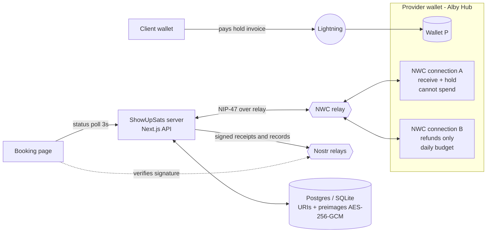

# ShowUpSats ⚡

**Booking links with Lightning deposits that are _locked, not sent_.**
Built for Dakar Bitcoin Hack 2026. Uses test wallets only: **TEST WALLETS · NOT REAL MONEY**.

## Problem → solution → impact → next steps

**Problem.** One-person service businesses like barbers, braiders, nail techs, tutors and phone repairers lose a large share of their income to no-shows. An empty chair on a Saturday morning is a day's rent gone. Asking for a deposit doesn't fix it, because clients don't trust it: they send money to a stranger and have no way to get it back if the stylist cancels.

**Solution.** ShowUpSats gives each provider a booking link. The client picks a slot and pays a small deposit as a Lightning **hold invoice**. The sats are locked in the client's payment, not sent. The provider has 10 minutes to tap **Accept**. Accept settles the invoice and the sats go straight to the provider's own wallet. Decline, or no answer in time, cancels the invoice and the client's sats never leave their wallet. Both sides get a **Nostr-signed receipt** that includes the hash of the exact cancellation policy they agreed to. The client also gets a **check-in code** that proves they showed up.

**Trust after settlement.** ShowUpSats never holds money, so it is not escrow. After the deposit settles, the client is protected in three ways. First, the provider agrees to a policy, and its hash is signed into the receipt. Second, a refund-only wallet connection, capped by the provider's own daily budget, pays refunds automatically when the provider cancels or the client cancels in time. Third, a public **show-up record** on every booking page shows completed bookings, refunded cancellations, unresolved no-shows and disputes, each backed by a signed Nostr event.

**Impact.** *Deposits protected per week = bookings × no-show rate × average deposit.* Take a braider with 25 bookings a week, a 15% no-show rate and a ₦1,500 deposit: that is ₦5,600 a week she would otherwise lose, recovered without a payment processor, a bank account or a platform taking custody. The same link works in any country and any currency.

**Next steps.** Keep same-day deposits locked until the appointment. Add a provider bond that clients can claim. Add USSD/SMS check-in for feature phones, publish slots to Nostr calendars (NIP-52), and take bookings from WhatsApp messages with AI intake.

---

## One-command setup

```bash
pnpm wallets   # optional: creates 2 faucet test wallets and writes them into .env
./dev.sh       # = pnpm i && pnpm db:push && pnpm seed && pnpm dev
```

Then open:

- http://localhost:3000/b/demo-braids is the public booking page.
- http://localhost:3000/login is the provider dashboard. The link name is `demo-braids` and the key is `demo-braids-dashboard-key-0001`.
- http://localhost:3000/onboard creates a new provider.

`./dev.sh` creates `.env` with a fresh `ENCRYPTION_KEY` and `APP_NOSTR_NSEC` the first time it runs.

### Test wallets (faucet.nwc.dev)

`pnpm wallets` makes two POST requests to `https://faucet.nwc.dev?balance=…`:

- **Wallet P (provider)** gets 10,000 sats and goes into `.env` as `SEED_NWC_RECEIVE_URI` and `SEED_NWC_REFUND_URI`.
- **Wallet C (client)** gets 50,000 sats and goes into `.env.local.wallets`. Paste its `nostr+walletconnect://` URI into Bitcoin Connect on the payment screen (click the QR panel and choose NWC) to pay deposits.

Faucet wallets are backed by Alby Hub and support hold invoices. A faucet wallet gives you one **full-access** connection, so the demo sets `ALLOW_TEST_FULL_ACCESS_NWC=1`. That lets the same faucet connection act as connection A, and the UI shows a warning when it does. With a real Alby Hub, create two separate connections as described in *Least privilege* below. Never set this flag in production.

### Proofs you can run

| Command | What it proves |
|---|---|
| `pnpm hold-test` | **M0 gate.** Creates a hold invoice for 100 sats, has wallet C pay it, waits for state `accepted` (held), then settles: P gains 100 sats. It repeats with a cancel: C is not charged. A second cancel returns `NOT_FOUND`, which the app treats as success. |
| `pnpm e2e` | The full booking state machine on real wallets: book → held → accept/settle → signed receipt verifies → wrong code rejected → check-in → completed. Timeout → swept → client balance unchanged. Accept → provider cancels → auto-refund via connection B → a replayed refund doesn't pay twice. |
| `pnpm test` | Unit tests, including the sats ↔ msats helper. |

The `DEMO_MODE=1` fallback is only for when the faucet is down. It simulates payments and shows a red **DEMO · SIMULATED PAYMENTS** banner. It is off by default.

### Production (Vercel + Postgres)

1. Set `provider = "postgresql"` in `prisma/schema.prisma` and set `DATABASE_URL` to Neon or Vercel Postgres.
2. Set every variable from `.env.example` in Vercel. Generate `ENCRYPTION_KEY` with `openssl rand -base64 32`, and set `CRON_SECRET`.
3. `vercel.json` runs the expiry sweep every 5 minutes. The sweep also runs on every status poll and every dashboard load.

## Architecture



**Flow:**

1. The server generates a preimage and `makeHoldInvoice(payment_hash)` runs on A.
2. The client pays. `lookupInvoice` returns `accepted`, which means held.
3. The provider taps Accept and the server calls `settleHoldInvoice(preimage)`.
4. If the provider declines or the deadline passes, the server calls `cancelHoldInvoice`.
5. Refunds resolve the client's Lightning address to an invoice, check that its amount matches exactly, then pay it with `payInvoice` on B.

Amounts are stored in sats and converted to msats only at the NWC boundary (`lib/units.ts`, unit-tested).

## Security

### Least privilege

- **Connection A (receive + hold).** Onboarding calls `get_info`. It requires `make_invoice`, `lookup_invoice`, `make_hold_invoice`, `settle_hold_invoice` and `cancel_hold_invoice`, and it **rejects** the connection if it includes `pay_invoice`, `pay_keysend` or the `multi_pay_*` methods. In Alby Hub, the hold methods come bundled with the `make_invoice` permission, so A can settle or cancel holds but **can never spend**.
- **Connection B (refunds only).** Must have `pay_invoice`. The UI tells the provider to set a **daily budget** in their wallet (we suggest 20,000 sats) and shows the cap via `get_budget`. The server only ever pays an invoice that it resolved itself from the **Lightning address recorded at booking time**, for exactly `depositSats`. It decodes the invoice and checks the amount first.
- Both URIs are encrypted with AES-256-GCM before they are stored. They are never sent to the browser and never logged. The same applies to preimages. The app nsec lives only in an env var.

### Threat model

| Asset | Threat | Mitigation |
|---|---|---|
| Connection A | Stolen from the DB or leaked | Encrypted at rest. Even in plaintext it **cannot spend**: onboarding rejects any connection with pay methods. The worst an attacker can do is create, settle or cancel invoices that pay the provider. |
| Connection B | Stolen | Encrypted at rest. Spending is capped by the wallet's daily budget, and the provider can revoke the connection in Alby Hub in one click. |
| Client deposit | Malicious provider never accepts | The hold auto-cancels at the deadline. The sweep runs on every poll, on every dashboard load and from cron, and it is idempotent. |
| Client deposit | Provider settles, then disappears | The client files a `provider_absent` report from the receipt page. The provider has 24 h to refund or dispute. Otherwise the report becomes a public, signed **unresolved no-show** on their booking page. |
| Slots | Squatting with unpaid holds | Slots are locked in a DB transaction (`open → held` via conditional update) with an overlap check. A client can have at most 3 pending holds and an IP at most 10. Booking creation is rate-limited. Unpaid holds expire. |
| Receipts | Forged or edited receipt | The receipt is a Nostr event signed by the app key. The browser verifies the Schnorr signature with `verifyEvent`, and the server re-hashes the policy text and compares it with the signed `policyHash`. |
| Deposit amount | FX manipulation | Rates are cached for 5 minutes. A per-currency sanity range rejects outliers, and a move of more than 20% within an hour is rejected. The deposit is clamped to 100–1,000,000 sats. |
| Payments | Replay or double click | Settle, cancel and refund use compare-and-swap status claims (`held → settling`). A refund is unique per booking and reuses its stored bolt11 on retry, and a bolt11 can only be paid once. `NOT_FOUND` or already-cancelled counts as success. |
| Check-in code | Brute force | Only a SHA-256 hash is stored. After 5 attempts check-in locks for 10 minutes, plus a per-minute limit. The code is valid only from 2 h before the slot to 2 h after. |
| Dashboard | Session theft | A 128-bit key is shown once and only its SHA-256 is stored. The session cookie is HMAC-signed, `httpOnly`, `secure` and `SameSite=strict`. Login is rate-limited. |
| Privacy | PII leak | No names or phone numbers are stored. Only the client's Lightning address is kept, because refunds need it. Records use a salted hash of the address. Audit logs hold IDs and the last 6 characters of payment hashes only. |

Every API input is validated with zod (`lib/validation.ts`), including amount bounds and a currency allowlist. Errors are shown in plain words with the next step to take; stack traces never reach the UI.

### Honest limits

- ShowUpSats **never holds funds**, so it **cannot force a refund after settlement**. Clients are protected by the confirm-or-refund window, the capped automatic refunds and the public show-up record.
- Records show **what each side reported, not proof**: *"Records are signed by ShowUpSats. They show what each side reported, not a court ruling."*
- Hold invoices need a wallet that supports them (Alby Hub today).
- The DEMO-mode payment simulator keeps its state in memory and is meant for local fallback only.

## Metrics to track

| Metric | How |
|---|---|
| Median time to accept | `Booking.acceptedAt − held time` (audit log) |
| % of holds auto-cancelled | `expired / (accepted + declined + expired)` |
| Deposits protected per week | bookings × no-show rate × average deposit |
| Refund success rate | `Refund.status = paid / all refunds` |
| Booking-page weight | `/b/[slug]` first-load JS **106 kB** (`next build`), target ≤ 150 kB |
| Lighthouse mobile | `/`: _TBD_ · `/b/[slug]`: _TBD_ (recorded after M10) |

## Judging criteria → where to see it

| Criterion | Where |
|---|---|
| Real Lightning use | `scripts/hold-test.ts`, `lib/server/wallet.ts`, `lib/server/bookings.ts` · video 0:25–1:50 |
| Security | *Security* section above · `lib/server/onboarding.ts` (permission checks) · `lib/server/crypto.ts` · video 1:50–2:25 |
| Nostr | `lib/server/nostr.ts` · `app/r/[id]/ReceiptVerify.tsx` (in-browser verification) |
| UX / low-bandwidth | `/b/[slug]` is server-rendered, 106 kB JS · EN/FR in `lib/i18n.ts` |
| Impact | Problem/impact paragraphs above · video 2:25–3:00 |

## Cut list status

Will be updated at code freeze.

## Credits

Photos: see `public/credits.txt` (royalty-free, Unsplash/Pexels). The app name lives in one constant: `APP_NAME` in `lib/config.ts`.
